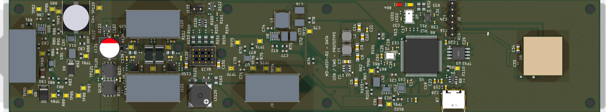
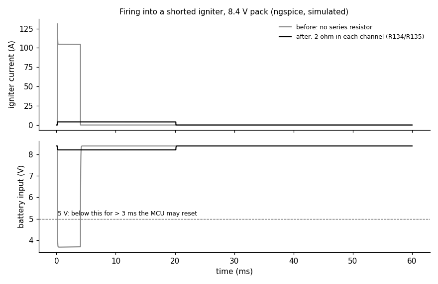
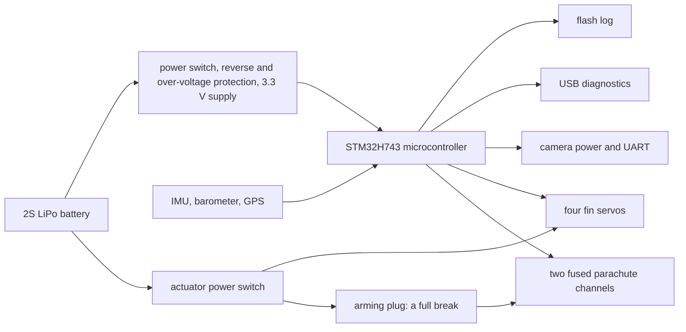

# Rocket Flight Computer (M3, design only)

> **Status: design only. No board has been built, powered or flown.** Every result below comes from CAD checks, circuit simulation or software tests on a computer, never from hardware.

This is a flight computer for a student high-power rocket. It is one 46 × 238 mm, four-layer circuit board that slides into a 54.66 mm inside-diameter airframe. It runs from a 2-cell LiPo battery, uses an STM32H743 microcontroller, reads an IMU (ICM-45686), a barometer (MS5611) and GPS (SAM-M10Q), logs to flash memory, talks over USB, powers a camera, drives four fin servos for roll control, and has two separately fused circuits to fire the parachute charge. The current design is revision **M3-ASSY-R2** (28 Sep 2026).



*KiCad 3D render of the top side of M3-ASSY-R2 (46 × 238 mm).*

## Demo

There is no video, because the board has not been built. What can be shown and re-run today:

1. **Board checks.** `tools/check.sh` runs KiCad's design-rule check, electrical-rule check and schematic-vs-PCB check. Output on 2026-11-01 (KiCad 10.0.6):
   ```
   DRC violations 0  unconnected 0  schematic parity 0  ERC 0
   metadata / 3D model audit: OK
   ```
2. **Circuit simulation.** The ngspice suite in `m3_design/sim_r2/` found a flaw in the design: with a fresh 8.4 V battery, firing into a shorted igniter pulled the battery below 5 V for 3.9 ms (long enough that the computer could reset and miss the second parachute charge) and pushed 131 A through a transistor rated for 112 A. Adding a 2 Ω pulse resistor to each channel fixed it in simulation (4.1 A, battery stays above 8.2 V).



*Simulated, not measured. Grey: before the fix. Black: with the 2 Ω resistors. The 20 ms pulse length is a rule the future firmware must follow.*

The portfolio page for this project is 8a ("Rocket Flight Computer Design").

## How it works



- **One board instead of two.** An earlier version split the design into an M1 power/actuator board and an M2 microcontroller/sensor board joined by harnesses; M3 merges them back into one board (one assembly order, no 21-wire harness); the old M1 board is kept in `reference/m1_power_actuator/`.
- **Safety by hardware.** The arming plug is a complete electrical break in the parachute circuit; a script (`m3_design/check_actuators.py`) reads the PCB copper and fails if anything bypasses it.
- **Easy to diagnose.** Test pads, voltage-sense dividers and fault lines on the power rails; the bench firmware (for the previous revision R1) reports them over USB, and the host tools in `diagnostics/` turn a report into a list of likely faults.
- **Every part checked.** All BOM lines were checked against the maker's datasheet for pinout, land pattern, polarity and 3D orientation (`docs/R2_VERIFICATION.md`).

## How to run it

No hardware is needed for any of these. Tested on macOS with KiCad 10.0.6, ngspice 46 and Python 3.9 on 2026-11-01.

```bash
git clone https://github.com/OAK-WJR/rocket-flight-computer.git
cd rocket-flight-computer

tools/check.sh                          # DRC + ERC + schematic parity + 3D/metadata audit (needs KiCad 10.0.x)
python3 m3_design/check_actuators.py    # arming / pyro / servo safety contract -> "actuator safety contract: OK"
python3 m3_design/sim_r2/run.py         # ngspice suite -> {'PASS': 135, 'OLD-FAIL': 6, 'INFO': 8, 'DEMO': 2}
python3 m3_design/sim_r2/plot_short.py  # redraws docs/images/shorted_igniter_sim.png (needs matplotlib)
python3 tools/export_fab.py             # Gerber zip + JLCPCB BOM/CPL into m3_design/assembly_review/fab/

python3 -m venv .venv && .venv/bin/pip install -r diagnostics/requirements-lock.txt
.venv/bin/python -m unittest discover -s diagnostics -t . -p 'test_*.py'      # 173 tests, OK (1 skipped)
(cd m3_firmware && PYTHONPATH=.. python3 -m unittest test_firmware test_gnss test_usb)  # 41 tests, OK

open m3_design/assembly_review/m3.kicad_pro   # open the design in KiCad 10
```

- KiCad must be **10.0.x** (older versions cannot open the files). On Linux/Windows set `KICAD_CLI=/path/to/kicad-cli` before `tools/check.sh`.
- `OLD-FAIL` rows in the simulation are the pre-fix design, kept on purpose for comparison.
- **Firmware build:** `m3_firmware/build.py` needs the Arm GNU Toolchain 15.2.rel1 in `m3_firmware/toolchain/` and the maker datasheet PDFs it hash-checks (not committed, for copyright). It also refuses to build for R2 on purpose, because no R2 firmware exists yet. Prebuilt bench images for the older R1 board are in `m3_firmware/build_assembly_*/`. Do not run them on an R2 board.
- **To make a real board** you would order it from JLCPCB with the files from `tools/export_fab.py` (see `docs/ORDERING.md`), then need a 2S LiPo, an ST-Link/SWD probe and a USB-C cable. None of this has been done.

## Repo layout

| Path | What is in it |
|---|---|
| `m3_design/assembly_review/` | The KiCad 10 project (the single source of truth): 14 schematic sheets, PCB, local footprints, symbols and 3D models, schematic PNG/SVG exports in `sheets/`, review notes |
| `m3_design/sim_r2/` | ngspice suite for the actuator and parachute circuits (`run.py`, `RESULTS.md`, `FINDINGS.md`, `plot_short.py`) |
| `m3_design/check_actuators.py` | Safety check that reads the PCB netlist |
| `m3_firmware/` | Bench diagnostic firmware v0.8.1 (C, STM32 HAL + TinyUSB) for the R1 board, pin bindings, host-side tests |
| `diagnostics/` | Python host tools: USB/SWD readout, log recovery, fault localisation, test-point map |
| `docs/` | Ordering guide, part-by-part verification, actuator merge record, design rationale, FMEA, simulation notes, design history |
| `quality_audit/` | Board audit: conflicting part numbers, 3D model paths, DRC/ERC evidence |
| `reference/` | Older boards kept for comparison: M1 power/actuator board, M3-ASSY-R1 |
| `tools/` | `check.sh` (board gate), `export_fab.py` (fabrication files), JLCPCB stock and orientation helpers |
| `STATUS.md` | Every requirement and what is and is not verified |
| `AGENTS.md`, `CLAUDE.md` | The rules given to the AI coding assistants (see Credits) |

## Results and honest limits

What is done (on a computer only):
- KiCad DRC, ERC and schematic parity all at zero; 183 placed parts, every one with a JLCPCB/LCSC part code.
- 135 simulation checks pass for the current design; the shorted-igniter flaw was found and fixed in simulation.
- 173 host diagnostic tests and 41 firmware host tests pass.

What is not done:
- **Nothing has been ordered, built, powered, measured or flown.** Simulations use datasheet models, not measured parts.
- No firmware exists for R2. The firmware here is bench diagnostics for R1 only; it has no flight logic, servo control or parachute firing.
- Servo stall current through the board (about 7.7 A with all four stalled) is an estimate, not a measurement.
- Fit in the sled and airframe, the arming plug hardware and the external power switch are still open (`STATUS.md`, `docs/R2_VERIFICATION.md` §4).

Other branches: `m3-assy-r11` is the development line. It holds the later redesigns R3 to R10 (Oct 2026) and the compact R11 candidate (Nov 2026), committed by a collaborator, and the R10 bench diagnostics; each earlier revision is in its history. They are not part of the R2 design described here.

## Credits

**Jerry Wu (Jiarui Wu):** the project and its requirements: one board that fits the 54.66 mm airframe, built-in USB diagnostics, at most three PCB iterations. I chose to merge the two earlier boards into one, set the system constraints, made the design decisions recorded as "owner rulings" (for example two independently fused parachute channels, and keeping the backup altimeter fully separate), and reviewed the layout, flagging routing problems such as unwanted zigzag traces.

**AI coding assistants:** they produced most of the schematics, PCB layout, simulations, firmware and scripts from my requirements and decisions.
- **Claude Code** wrote the design documents, drew the first schematics through the EasyEDA API, wrote the KiCad board, routing and check scripts, and ran the ngspice simulations. It proposed and chose the 2 Ω per-channel pulse resistors shown above; I approved them. It also merged pull requests #1–#5 on my account, so those merge commits show my name.
- **Codex** did the quality audit, the single-board versions up to M3-ASSY-R1, the bench firmware v0.1–v0.8.1 and the USB diagnostic tools.
- Commits made with Claude Code carry a `Co-Authored-By: Claude` line. `AGENTS.md` (read by Codex, and by Claude Code through `CLAUDE.md`) holds the safety and routing rules they had to follow.

**Collaborator and existing work:**
- **Ethan Huang** (collaborator) merged the four servo outputs, the two fused parachute channels with the arming break, the pull-pin and the buzzer into the board (pull request #1, 26 Sep 2026), also with Claude Code. He committed the later R3–R10 branches.
- **Open-source code and models:** TinyUSB (MIT), STM32CubeH7 HAL (BSD-3-Clause) and CMSIS headers (Apache-2.0) in `m3_firmware/vendor/`; KiCad library 3D models (CC-BY-SA 4.0 with exception); footprints and 3D models converted from the EasyEDA/LCSC library with easyeda2kicad. Details and licences: [THIRD_PARTY_NOTICES.md](THIRD_PARTY_NOTICES.md).
- **Tools:** KiCad 10, ngspice, Python, Arm GNU Toolchain; part data from maker datasheets and LCSC/JLCPCB pages (linked in the review notes, not copied).
