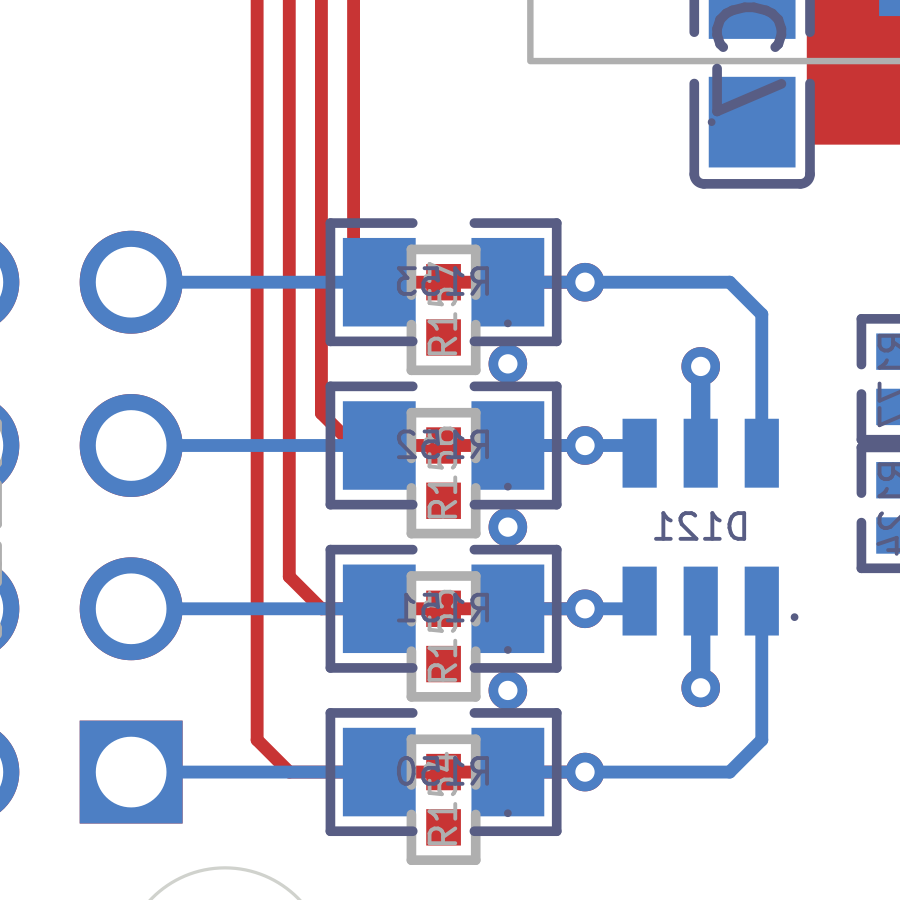

# Spike 3(b): servo bus through D121 to J122

**Verdict: the primary approach passed. D121 is not relabelled.** The pass-5 channel map (D121 pins 1/3/4/6 =
SERVO1–4_MCU) is kept, and `check_actuators` passes unchanged. The kill rule did not fire, so the relabel fallback was
not built (see "Fallback" below).

Gate on the scratch board (default variant; the In2 full-tongue variant gives the same result):

| Check | Result |
|---|---|
| Rigid copper (`check_r8.rigid`, all 12 D15 groups) | equal to R7's digests |
| DRC (kicad-cli, every severity): items that are spike copper or spike parts | 0 violations; 0 unconnected on SERVO nets |
| route_check `--profile r8`: SERVO nets, plus GND / 3V3 in the servo region | 0 gated instances. Information only: 2 `pad_end_offcentre`, 0.12 mm, at D121.3 / D121.4 |
| D121 and pull-down power pins reach their planes (connectivity) | yes: GND to In1 / F / B; D121.5 to In2 3V3 |
| D19 (PYRO1_GATE_N ≥ 0.5 mm from servo copper) | no gate copper within 2 mm; the nearest is the rigid exit via, 7.9 mm away |
| D20 (no In1 track; In2 tracks only on power nets) | no servo copper on any inner layer |
| Tie path (bottom courtyards ≥ 2 mm from the tie centre line, 4 mm path) | R150 2.20, R151 3.13, R152 4.06, R153 4.99, D121 7.05 mm |
| `check_actuators.py` on the scratch board | `actuator safety contract: OK` |
| Byte-identical rebuild | route board SHA-256 `96c48e02b151df50…`, the same on two runs |

## Design: lanes straight on F.Cu, rows on B.Cu, D121 at the vias

Image key: F.Cu red, B.Cu blue; aft is up; J122's signal column is on the left. The second image,
`servo_lanes.png`, shows the four lanes leaving U1.

- **F.Cu lanes.** Each lane runs from its pin U1.22–25 straight forward on the pin's own x, at 0.5 mm pitch, until it
  reaches its J122 row.
  - There it takes one 45° turn east.
  - Its pull-down R(153+i).1 sits on the row as a node.
  - The lane ends at a via.
- **B.Cu rows.** Each row is one straight line from the via to J122: via → 1k R(149+i) → J122.(3i−2).
  - The four B.Cu rows cross under the F.Cu lanes. This crossing makes the full reversal from U1's pin order to
    J122's row order. It is D7's "reversal after the taps, made by the 1k resistors and the THT pins".
- **D121 (SRV05-4) on B.Cu.** It is tapped from the four vias, at rotation 180.
  - Pins 3 and 4 are tapped straight on the S2 / S3 rows.
  - Pins 1 and 6 are reached round the row ends, with one 45° corner each.
  - Pin 2 (GND) takes a via north; pin 5 (3V3) takes a via south into In2 3V3.
- **Why each mid pin needs a via.** The B.Cu clamp lands on U1-ordered taps with the right handedness, as D7's
  `d121.py` model predicted. On any fan-in, both mid pins (2 GND, 5 3V3) lie between I/O pins, so each needs a via.
  This is topology, not placement.
- **Rotation.** D7 said rotation 90. That is for taps arriving from aft. Here the taps arrive from the via column on
  the west, so the rotation is 180. The B.Cu side is the same.

### Exact geometry (`servo_route.py`; board mm, y forward; U1 rot 0 at (23, 45); J122 rigid)

| Item | Value |
|---|---|
| Lane x (U1.22–25 pad centres) | S1 27.5, S2 28.0, S3 28.5, S4 29.0; from y 52.55 |
| Row y (J122.1/4/7/10) | S1 79.51, S2 76.97, S3 74.43, S4 71.89 (J122 signal column x 25.54) |
| F.Cu path per channel | (x, 52.55) → (x, y−0.5) → (x+0.5, y) → (30.4, y) [R(153+i).1] → (32.6, y) [via] |
| B.Cu path per channel | (32.6, y) → (31.4, y) [R(149+i).1]; (29.4, y) [R(149+i).2] → (25.54, y) [J122] |
| R150–R153 | B.Cu, rot 180 (pad 1 / MCU east), centre (30.4, y) |
| R154–R157 | F.Cu, rot 270 (pad 1 on the row, pad 2 GND at y+0.86), centre (30.4, y+0.43): directly above the 1k parts, on the opposite face |
| Signal vias | 0.6 / 0.3 mm at (32.6, y), one per channel |
| D121 | B.Cu rot 180 at (34.4, 75.70): 1 NE (35.35, 76.85), 2 N GND, 3 NW (33.45, 76.85), 4 SW (33.45, 74.55), 5 S 3V3, 6 SE (35.35, 74.55) |
| D121 taps | S2: (32.6, 76.97) → (33.45, 76.97). S3: (32.6, 74.43) → (33.45, 74.43). S1: (32.6, 79.51) → (34.85, 79.51) → (35.35, 79.01) → (35.35, 76.85). S4: (32.6, 71.89) → (34.85, 71.89) → (35.35, 72.39) → (35.35, 74.55) |
| D121 power | pin 2 → GND via (34.4, 78.20); pin 5 → 3V3 via (34.4, 73.20); 0.3 mm tracks |
| GND stitching | vias (31.4, 73.16), (31.4, 75.70), (31.4, 78.24): one in each F.Cu / B.Cu pocket between rows |
| Widths | 0.2 mm signal, 0.3 mm power stubs; F.Cu lane gap 0.30 mm (2 × the 0.15 mm rule) |

## Measurements (`result_summary.json`)

| Net | Copper mm | Octile MST mm | Ratio | Vias | F.Cu | B.Cu | Bends |
|---|---:|---:|---:|---:|---:|---:|---:|
| SERVO1_MCU | 38.08 | 33.60 | 1.13 | 1 | 31.77 | 6.32 | 4 |
| SERVO2_MCU | 30.78 | 28.51 | 1.08 | 1 | 28.73 | 2.05 | 2 |
| SERVO3_MCU | 27.74 | 25.77 | 1.08 | 1 | 25.69 | 2.05 | 2 |
| SERVO4_MCU | 28.96 | 25.97 | 1.11 | 1 | 22.65 | 6.32 | 4 |
| SERVO1–4_OUT (each) | 3.86 | 3.86 | 1.00 | 0 | 0 | 3.86 | 0 |
| **Family** | **141.0** | **129.3** | **1.09** | **4** | **108.8** | **32.2** | **12** |

Against R7 (`survey_connectivity`):

| | R7 | This spike |
|---|---:|---:|
| Copper | 435 mm | 141.0 mm |
| Signal vias | 28 | 4 |
| On In2 | 251 mm | 0 mm |

The non-signal vias added are D121's 2 power vias and 3 GND stitching vias.

**Clearances:**
- Servo to servo: 0.30 mm track to track. At U1 it is 0.20 mm pad to pad, which is the 0.5 mm pin pitch.
- Servo to other nets: 0.20 mm at U1's pads (the pin pitch); elsewhere 0.282 mm minimum (1k pad to a pocket GND
  via, B.Cu).
- J122 signal pin to RAW_ACT pin: 0.94 mm, set by the header.

**Pyro distances (plan view):**
- PYRO1_BUS / IGN / OUT: ≥ 5.63 mm. R7's tightest rule-F gap (0.503 mm, at a SERVO4_MCU via) no longer exists.
- Gate copper: ≥ 7.9 mm.

**References:**
- Every F.Cu lane runs over In1's solid GND.
- Default In2 under the B.Cu servo copper: 13.7 mm over GND, 9.7 mm over the 3V3 tongue (D121 taps only), 8.7 mm in
  antipads.

## What later steps must take from this

- **In2 (spike (c), step 5).** The placeholder model here is not the decision, but the servo copper needs this:
  - **Default, passes:** In2 GND under the B.Cu rows west of the via column (x 25.0–32.95, y 70.9–80.5), as r8_plan
    §1 says ("In2 GND under every servo lane").
  - A 3V3 tongue only under D121 (x ≥ 32.95, y 66.5–81). D121.5's via at (34.4, 73.2) must land in In2 3V3. The tongue
    joins the 3V3 region (y ≤ 66.8) along x 33–37, where U2 / C8's 3V3 already sit.
  - **Variant, also passes:** a full 3V3 tongue under the rows (`run.sh DIR in2-full-tongue`).
  - **Not acceptable:** RAW_ACT under the rows. The In2 RAW_ACT island under J122's middle column must stay west of
    x ≈ 24.5 for y 70.9–80.5.
  - If In2 must be GND under D121 too, D121.5 needs an F.Cu 3V3 feed instead: about 7 mm and one more via, south to the
    3V3 region. That case was not built.
- **Placement (step 4): keep-clear areas.**
  - **F.Cu:** x 27.3–29.1 from U1's forward face to y 79.6; the rows y_i ± 0.1 out to x 32.9; the pull-down courtyards
    x 29.93–30.86, y 71.41–80.86.
  - **B.Cu:** x 25.4–36.2, y 70.9–80.5. That covers the rows, R150–R153 (courtyard x 28.54–32.27), D121 (courtyard
    32.65–36.16 × 73.72–77.69) and the taps.
  - **Nothing needs to cross the F.Cu lanes.** Every net east of them is an east-face net: camera, status, RAW_ACT
    sense, power. Pins 17–21 escape west of x 27.3. The 3V3A pins 20/21 have room for a via at x ≤ 26.8.
- **The seed's D121 / pull-down spot is superseded.** The seed (`partial/b0_place_final.tsv`) had D121 and R154–R157
  on top at (26–31, 57–62).
  - The plan_partial "servo via field" at x 27–31, y 54–58 is not used, so it is free for spike (a).
- **The RAW_ACT_SENSE divider sat in the D121 spot in the seed.** It was moved east here: R177 / R124 at x 37.4,
  R125 / R182 / C122 at x 39.6–39.8, y 72.5–78.8.
  - That placement keeps rule H: R177.1 (RAW_ACT) is 1.9 mm from R124.2 (RAW_ACT_SENSE).
  - Step 4 owns its final home, which must be east of x 36.2.
- **Silkscreen (post stage).** The 15 DRC silkscreen warnings on spike parts are footprint-default designators sitting
  over the 2.54 mm-pitch rows.
  - They are designator placement, not copper.
  - The R8 post stage places or hides them, as r7_post does with its courtyard test. There is no room between the rows
    on either face, so expect them outboard or hidden and listed.
- **Assembly.** Each top 0402 pull-down sits directly above its bottom 0805 1k, on the opposite face. That is normal
  double-sided PCBA (Inference: no JLC rule against coincident opposite-face parts was found or checked here).

## Finding for the orchestrator: the strip_gcpw digest is sensitive to zone-fill noise

The servo copper changes no rigid digest. With and without it, the GCPW profile is identical.

The scratch board does keep R7's four F.Cu power pours: R6_RAW_ACT_F, BAT_IN_F, RAW_ACT_F and R6_BAT_IN_crossbar_F.
They are far from the strip and from the servo interface.

- **Deleting all four together** shifts 13 of `check_r8.gcpw_profile`'s 0.01 mm samples by one step, on all 8 RF
  lines (for example 0.27 → 0.28 mm). Nothing in the strip moves. `strip_gcpw` then fails.
- **Deleting any one of the 41 non-kept R7 zones alone** shifts nothing. This was tested.
- **Reproduce:** `SPIKE_DROP_FCU_POURS=1 run.sh DIR`.

This is native fill numerical noise reaching the quantised profile.

Step 4/5 will delete those R7 pours. The real build may then see `strip_gcpw` fail with no strip change. I did not
change the check. How to treat this is an orchestrator / step-1-tool question:
- re-baseline the group by a recorded decision; or
- give the profile a one-step tolerance; or
- fill the strip region in isolation.

## Fallback (relabel D121): not needed

The primary passed, so no relabel was built. A relabel would also buy little:
- With some channel assignment, one mid pin could face away from the taps. That would save at most one power via:
  the GND via, since pin 2 could then reach the B.Cu GND pour.
- That is not worth a `check_actuators` 7c contract change.
- D7 / D14 stand as decided.

## Decisions to record in R8_DECISIONS (proposed; this spike edits only its own folder)

1. **Servo bus topology (refines D7).** The design is the one above: F.Cu straight from U1.22–25 to J122's rows,
   pull-downs on the rows, one via per channel, then straight B.Cu rows through R150–R153 into J122. D121 sits on B.Cu
   at rotation 180, tapped from the four vias.
   - Basis: D7, r8_plan §1, plan_partial §5.4, and this spike's DRC, route_check and hash results.
2. **In2 under the servo interface.** GND under the rows and a 3V3 tongue under D121 for D121.5's via. RAW_ACT stays
   west of x 24.5 there.
   - Basis: r8_plan §1, and D121.5 = 3V3 (check_actuators 7c).
3. **The strip_gcpw fill-noise finding**, for whoever owns check_r8's rigid baseline (D15).

## Files

| File | Content |
|---|---|
| `run.sh` | Builds the scratch board from git 431025d and verifies it. Usage: `run.sh SCRATCH_DIR [in2-full-tongue]`, about 6 s |
| `make_base.py` | Scratch base: R8 nets, TH1–3 out, rigid copper only, seed placement with rigid parts never re-placed, In2 placeholder planes |
| `servo_route.py` | **The geometry to reuse:** constants, placement, `check_pads` (refuses to draw if the pads differ), `route()` |
| `verify.py` | The gate above, plus the measurements |
| `seed_b0_place_final.tsv` | Copy of the survey's Strategy B seed placement |
| `result_summary.json` | Gate, rigid digests, DRC and route_check counts, route figures, clearances, tie distances and part positions, for both In2 variants |
| `servo_interface.png`, `servo_lanes.png` | Copper views, fills hidden |
| `PROGRESS.md` | Running log |
